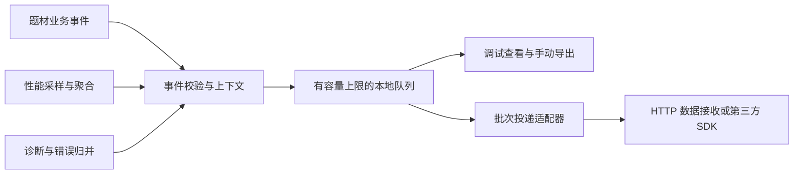

# 单机验证、数据采集与 SLG 演进建议

2026-10-12。以下均为待讨论建议，未新增对应运行模块或第三方 SDK。目标是先验证题材和单机体验，收集可用于决策的行为与性能数据，并降低未来 SLG 的业务迁移成本。暂按离线优先、后续可增加自动上传设计；实际首轮测试范围和指标重点待用户补充。

## 1. 建议的优先顺序

| 顺序 | 建议工作 | 原因 | 该阶段验收结果 |
| --- | --- | --- | --- |
| P0-1 | 存档可靠性与数据版本 | 单机玩家进度是后续测试和数据解释的基础 | 写入中断/取消不破坏旧档；损坏可恢复；旧版本可迁移；同一档并发写有序 |
| P0-2 | 统一数据采集基础：行为、性能、诊断 | 首批用户回来后能知道发生了什么、卡在哪里 | 本地持久记录、可查看/导出；采集可以关闭；断网不影响玩法；有字段版本与数据环境 |
| P0-3 | 一个最小单机玩法闭环，附版本化配置和纯数据状态 | 框架按钮只能验证 API，无法评价题材/节奏 | 进入 → 引导 → 核心行为 → 结果/奖励 → 保存 → 再次进入；数据能回答具体假设 |
| P1-1 | 一个代表性移动端构建与性能基线 | Editor 运行不能说明设备可运行或数据准确 | 有真实离线资源包、IL2CPP 构建和真机记录；生命周期/恢复/内存检查通过 |
| P1-2 | 采集服务适配、批量上传和集中分析 | 离线导出不适合扩大测试规模 | 跨启动补传、服务端确认/去重、可按题材和版本看数据；所需服务单独选型 |
| P1-3 | 生命周期/时间/配置/任务队列 | 让放置、建造、研究等单机系统以后容易联机化 | 暂停/重启任务可恢复，离线收益可解释，配置版本能对应玩家行为 |
| P2 | HybridCLR、TouchSocket 联机状态适配、SLG 地图及更大规模压测 | 此时已有可复用业务状态和设备证据 | 逐项验收热更/同步/地图性能，而不是把联网传输接上就当作转 SLG 完成 |

P0 的业务分层约定应一开始执行；无需等到实现 SLG 才从 UI 中拆出数据。TouchSocket 的接入次序可后移，但服务接口边界可先保留。

## 2. 数据采集模块建议

建议三种功能共享上下文和投递通道，业务调用接口分开：

- Analytics：记录玩法事实和关键行为。
- Performance：记录性能窗口和加载耗时。
- Diagnostics：记录错误、异常和环境信息。

建议落在 GameCore/Module 下；平台/供应商实现使用独立程序集或适配目录。题材事件、配置 ID、经济规则属于 GameRuntime。底层可以称为 TelemetryModule，命名尚未定案，接口也尚未实现。

离线阶段先实现记录、恢复和导出；自动上传阶段再确定接收服务/供应商。日志面板和 GameEvent 保留各自职责：游戏事件可选择性映射成埋点，避免自动记录全部内部事件造成字段不稳定和数据量失控。

### 2.1 通用上下文

建议事件至少包含：event_id、event_name、schema_version、发生时间、session_id、随机 installation_id、demo_id、app_version/build_id、config_version、content_version、environment、平台和粗粒度设备档位。可选 experiment_id/variant、关卡或场景标识。

installation_id 不能代表跨设备玩家身份。后续账号上线时增加 player_id，并明确身份关联策略。对时间同时记录 UTC 和会话内单调经过时间，避免系统时间调整破坏耗时和事件顺序。导出/补传保留事件发生时的上下文，不套用上传时的新版本或新会话。

多种题材共用基础事件和字段；各题材扩展自己的业务字段。不同 Demo 要有独立存档命名空间和数据标识，避免测试互相污染。开发、内测、正式数据分环境；Editor、自动测试和演示点击默认不进入正式玩家分析。

### 2.2 埋点从“要回答的问题”开始

| 要回答的问题 | 建议事件 | 必要业务字段 | 解释限制 |
| --- | --- | --- | --- |
| 用户能否成功开始？ | session_start、startup_stage_completed/failed、first_play_started | 实际工作耗时、资源版本、失败分类 | 当前人为展示等待要独立记录；Editor 数据单独归类 |
| 引导在哪里流失？ | tutorial_step_started/completed、first_core_action | 引导步骤、尝试次数、题材版本 | 不要仅凭 session_end 判断退出；后台/关闭可能没有结束回调 |
| 核心循环有没有吸引力？ | run_started/completed、milestone_reached | 结果、耗时、难度、重试次数 | 会话时长需排除后台时间，完成率要统一分母 |
| 玩家卡在什么地方？ | action_rejected、progress_blocked | 失败原因、目标/资源差额、进度阶段 | 为明确业务阻塞打点，避免每帧重复打点 |
| 数值节奏是否合适？ | resource_changed、upgrade_started/completed | 资源类别、变化量、原因、目标等级、消耗/等待 | 记录经济变动的业务事实，避免逐秒产出写出海量事件 |
| 哪个题材更值得继续？ | 上述共用事件 + demo_id | 获取渠道、版本、设备档位、实验分组 | 对齐测试人群和时间窗口；仅跨 Demo 原始时长不能证明题材优劣 |
| 有多少回访用户？ | session_start | 稳定安装标识、发生日期、题材与版本 | 数据未导出/未上传的用户不可直接视为未回访；卸载/换设备影响识别 |

首批保留约 10–15 个明确事件即可，事件目录应列出触发时机、字段/单位、允许值、去重口径、负责人和 schema 版本。经济、升级和队列事件可在单机阶段先统一语义，后期由 SLG 状态处理继续复用。

### 2.3 可靠记录与投递

建议采用小批次 JSONL/分段文件或成熟持久队列实现，避免每次打点改写一个不断增大的 JSON 数组。写入队列独立于用户进度档；客户端只保证可描述的有限持久性，记录被 OS 强杀前尚未落盘的数据可能丢失。

需要：容量/条数上限、轮转、保留期、优先级、重复错误限流、应用前后台处理、恢复、重试退避、网络/电量策略、字段验证和敏感内容过滤。建议先提供可配置的小容量预算，例如 5–10 MB 和 7 天；预算值需按测试频率与事件大小实测调整，不能默认无限保存。

自动上传采用 event_id 去重和批次确认：成功确认后才删除本地待传数据；部分失败按确认范围处理。客户端重试可能重复发送，接收端需按 ID 去重，不能靠客户端承诺“恰好一次”。上传结果、队列丢弃数量和失败原因要可见。若采用第三方 SDK 的缓冲/队列，要明确持久性和确认边界，避免自建队列与 SDK 队列叠加却没有正确确认。

Unity Analytics 自带缓冲、批量上传和有限离线缓存，可作为供应商适配候选；是否满足本项目的断电恢复、容量和导出需求，应按选定 SDK 版本实测。[Unity Analytics SDK 行为说明](https://docs.unity.com/en-us/analytics/sdks-and-apis/sdk-behaviour)

业务只依赖自己的采集接口，供应商 SDK 可作为可插拔实现。远程数据接收可使用独立 HTTP 适配，与后续 TouchSocket 游戏会话传输分别维护；单机游戏上传数据不要求先实现 SLG 游戏服务器。

### 2.4 用户数据边界

建议同时支持未启用、仅本地诊断、允许远程采集等明确模式，并提供关闭、清理和按实际发行需要配置的授权流程。默认不采集姓名、邮箱、硬件唯一标识、聊天内容或完整存档；日志/异常中也要过滤用户输入和私有路径。

供应商的初始化和停止/删除能力按具体 SDK 适配。Unity 2022.3 项目不能直接套 Unity 6.2 的 Developer Data/EndUserConsent 示例；Unity 官方文档按引擎/SDK 版本区分接入流程。最终 SDK 版本和用户数据规则仍需确定。[Unity Analytics 数据收集控制说明](https://docs.unity.com/en-us/analytics/privacy-and-consent/manage-data-privacy)

## 3. 性能与诊断建议

现有 Debugger 可作为开发查看入口；增加一个 PerformanceCollector，持续采样并聚合为小窗口，再交给数据管道。不要直接定期运行 Debugger 的“遍历全部对象取内存”功能：当前实现枚举 Resources.FindObjectsOfTypeAll，会带来额外工作量，适合手动检查。

| 层次 | 建议首批采集项 | 推荐方式 |
| --- | --- | --- |
| 加载 | 启动各阶段、场景/窗口/资源加载的工作耗时、失败分类、缓存状态（可获得时） | 操作计时；排除演示停留，绑定 package/content_version |
| 帧表现 | 平均/中位帧时间、P95/P99、超帧预算比例、严重长帧数量 | 每帧只更新有界统计；约 10–30 秒输出聚合；区分加载与稳定玩法 |
| 内存与 GC | Unity 已分配/保留内存、托管堆、GC 分配量/窗口累计、峰值、低内存回调 | 间隔采样，保留单位和支持状态；不把 Unity 内存值叫作整机/进程 RSS |
| 可选渲染计数 | Draw Calls、Triangles 等可用计数器 | 按设备运行时枚举/检测计数器，缺失值记 unavailable |
| CPU/GPU | 主线程、渲染线程、GPU 时间（可用时） | 后续加上能力检测与图形 API 标签，不能把所有帧时间当成 CPU 工作时间 |
| 错误 | 去重异常、加载失败、存档失败、关键任务失败 | 保留错误类、堆栈指纹、版本、场景/操作；次数聚合与限流 |
| 非正常结束 | 上次会话未正常收尾的提示 | 只标记 suspected_abnormal_exit；OS 杀进程/断电/强退并不等于崩溃 |

目标帧率 60 对应约 16.7 ms，30 对应约 33.3 ms；以目标预算解释超时比例。平均 FPS 可能掩盖卡顿，应结合帧时间分位数。暂停/后台无渲染期间单独记录，不混入正常游戏帧。

Unity 2022.3 的 ProfilerRecorder 支持 Editor 与 Player（包括 Release Player），可以读取可用计数器和标记时间；计数器要做运行时能力检查，Recorder 结束使用时 Dispose。[Unity 2022.3 ProfilerRecorder](https://docs.unity3d.com/2022.3/Documentation/ScriptReference/Unity.Profiling.ProfilerRecorder.html)

FrameTimingManager 提供帧时序能力，其支持范围和必要设置与平台/图形 API 有关，应按目标设备验证，缺失的 GPU 数据不得填写为 0。[Unity 2022.3 FrameTimingManager](https://docs.unity3d.com/2022.3/Documentation/Manual/frame-timing-manager.html)

建议先设一个采集自身的开销预算，在代表性手机上对比开关采集后的 CPU、分配和功耗；可用“约 0.2 ms 主线程/帧”作为讨论起点，最终值以测量为准。每帧不要序列化、写盘或发请求。指标样本采用有界缓存/直方图，避免采集器自己制造 GC 和卡顿。

托管异常记录不能覆盖全部原生崩溃/ANR/OOM。对外发布时再评估适用设备的崩溃 SDK、符号文件留存和构建 ID 关联；当前仅实现低成本错误诊断即可。纯客户端采集也不能单独提供可靠的后台留存/漏斗看板，集中分析阶段还需数据存储与查询能力。

## 4. 为后期 SLG 提前保留的业务结构

### 4.1 单机状态与执行接口

业务状态采用可保存的普通 C# 数据：PlayerState、经济/库存、建设/研究任务、地图实体等。避免把 Canvas/GameObject 或资源句柄放入存档。界面提交业务意图，例如 UpgradeBuilding/StartResearch，通过应用服务得到结果并刷新视图。

早期服务由 Local 实现检查规则并更新状态；联机后 Remote 实现发送命令，使用服务端确认/状态快照或增量更新。客户端需要处理请求中状态、拒绝、重试、断线和版本差异。可以复用接口、显示和配置，但经济、结算、计时的权威来源要重新验收，不能把 Local 服务简单换成 Socket 就认为完成联网。

建议保留稳定实体 ID、命令 ID、状态 revision 和配置版本；是否支持预测/回滚按真实玩法决定，首阶段不用搭建完整预测系统。

### 4.2 时间与任务

新增 IGameClock 或类似服务：区分本地 UTC、单调经过时间、日历时间与将来的服务器校准时间。持久任务保存开始/完成时间、类型、实体 ID、配置版本和状态，运行时 Timer 只负责刷新显示/触发检查。

离线结算采用明确规则（上限、产出速率、时间回拨处理）；重启/后台恢复时重算，不依赖每帧计时器继续运行。后续 SLG 由服务器提供可信完成时间和结果，客户端主要展示和请求确认。

### 4.3 配置和多题材复用

优先建立版本化配置与校验，继续评估现有 Luban 工具；不用另造完整转表器，但要补齐本工程缺失的 Configs/生成/加载链路。每份存档和事件关联配置版本，升级后能解释玩家数值变化。

建议先共用数据采集、存档、时间、配置、资源/UI、生命周期和平台能力；战斗、城建、塔防、放置等题材模块属于 GameRuntime 的可选模块。一个框架测试 Demo 加一个玩法 Demo 即可起步；出现第二个题材的真实需求后再抽共用接口，避免预先构建万能玩法框架。

### 4.4 SLG 地图和客户端规模

大地图、分区加载、可见范围对象池、LOD、列表虚拟化、地图坐标/实体 ID、相机与输入边界放在可选地图模块。当前小舞台和 LoopScroll 单元池用例没有覆盖该负载。到达需要地图验证的阶段再做稳定对象数量、长时间运行、移动设备内存和大列表压测。

TouchSocket 放在独立网络适配层，处理连接、协议、重连和取消等；业务状态同步、幂等命令和版本处理在应用服务/状态层，避免 UIWindow 直接发协议、修改全局经济。

## 5. 建议下一轮最小交付

建议下一轮先聚焦“可靠存档 + 可观测性”，再选一个题材承载用户测试：

1. 可靠存档：有序写入、可替换存储接口、临时写入与备份、schema_version、迁移/恢复结果；验证取消和强制中断边界。
2. 数据采集：少量类型明确的事件、版本/题材/会话上下文、有界持久队列、本地查看、JSONL/CSV 导出、关闭/清理；只做离线链路也能开始内测。
3. 性能采样：帧时间/内存窗口、加载真实耗时、低内存及错误聚合；新增专项测试界面查看结果、队列大小和采集开销。
4. 单机最小业务：使用配置、纯数据状态、应用服务和存档构成闭环，自动打关键业务点。
5. 第一种移动设备构建：核验离线资源、暂停恢复、采样可用性、长期运行与数据导出/回收策略。

到“离线队列可靠、数据能回答问题、用户范围确定”后再选自动上传供应商。报告提出的是顺序与边界，没有代表用户选择具体 SDK、联网服务或最终题材。

## 6. 本轮核对依据

当前源码：TEngine 各 Module/Core，GameCore 的 UI/资源引用/存档，Launcher/Procedure，GameRuntime 专项界面，Packages/manifest.json，各本地包 package.json；最近 demo-test-results 和既有 EditMode 结果。

技术参考为上文链接的 Unity 2022.3 性能 API、Unity Analytics 行为和版本化数据收集控制官方文档，查阅于 2026-10-12。第三方 SDK 未实际接入/兼容验证，正式选择前需核对目标平台、Unity 2022.3 支持、数据导出能力和费用。
